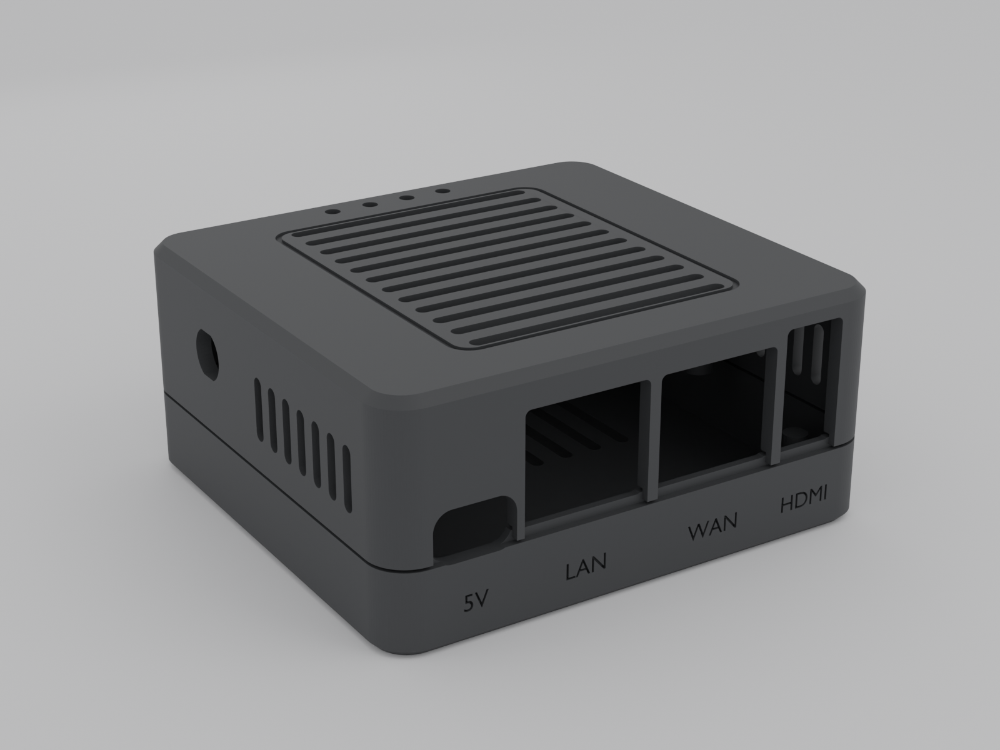

# NanoPi R5C enclosure (3D printed)

Two-part case for the FriendlyElec NanoPi R5C, with the M.2 Wi‑Fi card and two external antennas.
- **Size:** 63.2 × 67.7 × 30.7 mm.
- **Front:** USB‑C power, LAN, WAN and HDMI openings, with labels.
- **Top:** a vent grille and four LED light-pipes (WiFi, LAN, WAN, SYS).
- **Sides:** vents and two RP‑SMA antenna mounts.
- **Assembly:** two hidden screws underneath.



| File | What it is |
|---|---|
| `stl/R5C_case_plate.stl` | Both parts on one plate (136.4 × 67.7 mm), oriented for printing. Load this to print a whole case in one go. |
| `stl/R5C_case_hood.stl` | Top shell, already oriented for printing (top face down) |
| `stl/R5C_case_tray.stl` | Bottom shell, oriented for printing |
| `stl/fit_test_front_hood.stl`, `stl/fit_test_front_tray.stl` | The front 9 mm of each part, for checking port fit before a full print |
| `R5C_case.blend` | Blender scene with both parts and a simplified R5C reference model (in its own collection) |
| `build_case.py` | Parametric source. Every dimension is a named parameter at the top. |
| `renders/` | Preview renders |

## Where the dimensions come from

- **Exact, from FriendlyElec's CAD file** (`NanoPi_R5C_2209.dxf`, from the R5C wiki): board outline, mounting holes, and every port's position along the edge.
- **Estimated from FriendlyElec's photos:** component **heights**, since the drawing is 2D. **Measure these before a production run:**

| Parameter in `build_case.py` | Value used | What to measure (from top of PCB) |
|---|---|---|
| `RJ45_H` | 13.8 mm (opening allows 13.8 + 0.35) | Top of the Ethernet jacks |
| `HDMI_H` | 15.4 mm (opening allows 15.4 + 0.35) | Top of the upright HDMI socket |
| `USBC_H` | 3.26 mm | Top of the USB‑C socket |

Also check:
- The board's mounting holes pass an M2 screw.
- Nothing on the underside sits at the support-post spot (53.75, 56.3), the corner under the HDMI socket. The drawing shows that spot 2.08 mm clear of any part.

**Print the two fit-test pieces first** (about 30 minutes). Then test the board's ports by pushing the board up to the front wall and plugging in real cables.

To change a value, edit `build_case.py` and run:
```bash
/Applications/Blender.app/Contents/MacOS/Blender -b -P build_case.py -- --render
```
Every run rebuilds both parts and re-checks them:
- Both parts must be watertight (0 non-manifold edges).
- Neither part may overlap the board model, its connectors, the heatsink, the Wi‑Fi card or the antenna hardware.
- Hood and tray must not overlap each other.

The check is proven to catch problems: it reports a jack only 1.5 mm taller than the model. The script then re-exports the STLs, the `.blend` file and, with `--render`, the renders.

## Parts list (per unit)

| Qty | Part | Notes |
|---|---|---|
| 2 | M2 × 18 mm countersunk (flat-head) screw | They cut their own thread in the plastic. Snug, don't overtighten. |
| 1 | Aluminium heatsink, ≤ 19 × 19 mm footprint, ≤ 11 mm tall, with thermal tape | On the RK3568 chip. **Required:** the plastic case can't cool the chip the way FriendlyElec's aluminium case does. |
| 2 | RP‑SMA female bulkhead pigtail, ¼"‑36 thread, ≥ 10 cm, MHF4 plug | Check the plug type on your Wi‑Fi card (M.2 cards are usually MHF4) and reuse the kit's pigtails if they fit |
| 2 | RP‑SMA dual-band (2.4/5 GHz) antennas | |
| 4 | 2 mm clear acrylic (PMMA) rod, 17.5 mm long | LED light-pipes. Push in from inside; a drop of CA glue holds them. |
| 4 | 10 mm round rubber bumper, ~2–3 mm tall | Sits in the 1 mm recesses. Also lifts the floor vents off the table. |

## Printing

- **Material:** PETG or ASA. **Not PLA:** it softens around 55–60 °C, which the board and heatsink can reach.
- **Settings:** 0.2 mm layers (0.16 mm for a finer finish), 4 walls, 5 top/bottom layers, 20 % gyroid infill.
- **No supports needed.** Measured on the exported files:
  - **Hood:** the only overhangs are 0.8 mm-wide groove ceilings around the grille, plus tiny bridges at the vent ends and antenna-hole flats.
  - **Tray:** the only overhangs are the 10 mm feet-recess ceilings, which bridge easily and are hidden by the feet.
- Print the hood as exported (top face down) so the top is the smooth bed-side finish. Print the tray as exported.
- The narrowest feature is the 1.0 mm web between the USB‑C and LAN openings, which is 2 perimeters at 0.4 mm. Handle the hood gently before assembly.

## Assembly

1. Fit the Wi‑Fi card to the M.2 slot under the board and connect both pigtails.
2. Stick the heatsink on the RK3568 (the large chip marked "Rockchip").
3. Mount the two antenna bulkheads in the hood's side holes, flats aligned, and tighten the nuts inside.
4. Press the four light-pipe rods into the holes in the top from inside.
5. Set the board on the tray's two standoffs and support post. Route each pigtail up through the gap along that side of the board.
6. Lower the hood straight down. The port openings are open at the bottom, so it slides over the ports.
7. Turn the case over and drive the two screws in from underneath. They pass through the tray and board into the hood and clamp everything together. The hood also presses on the third mounting hole. That hole can't take a screw because the Wi‑Fi card covers it underneath.
8. Stick on the four feet.

## Heat: test before selling

Not yet tested. Airflow goes in through the floor and side vents and out through the top grille, and the heatsink sits 5 mm under the grille. Run a stress test with the case closed at room temperature:
```bash
stress-ng --cpu 4 --timeout 20m & watch -n5 cat /sys/class/thermal/thermal_zone0/temp
```
The RK3568 starts slowing itself down around 85 °C (reading 85000). Aim to stay well below that, around 75 °C or less, under load. If it runs hotter, use a taller heatsink (up to 11 mm fits) before changing the vents.
