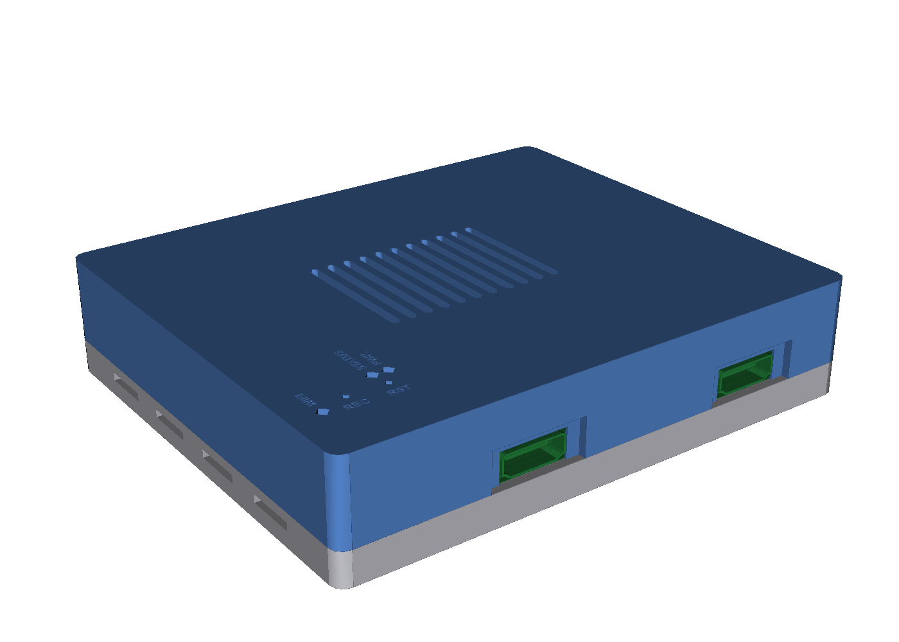
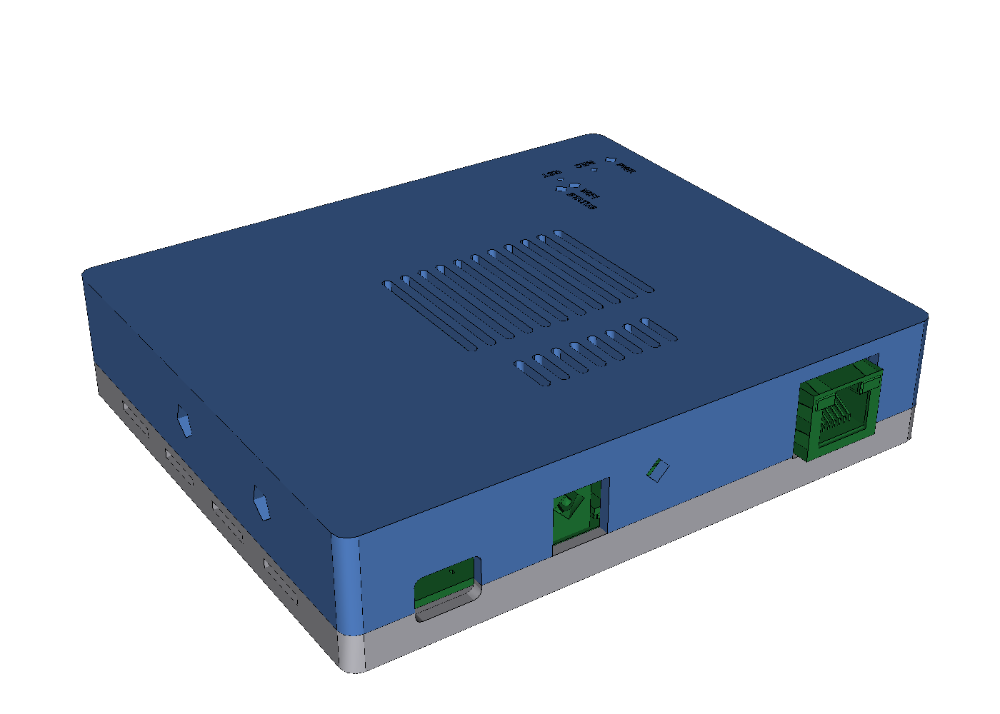
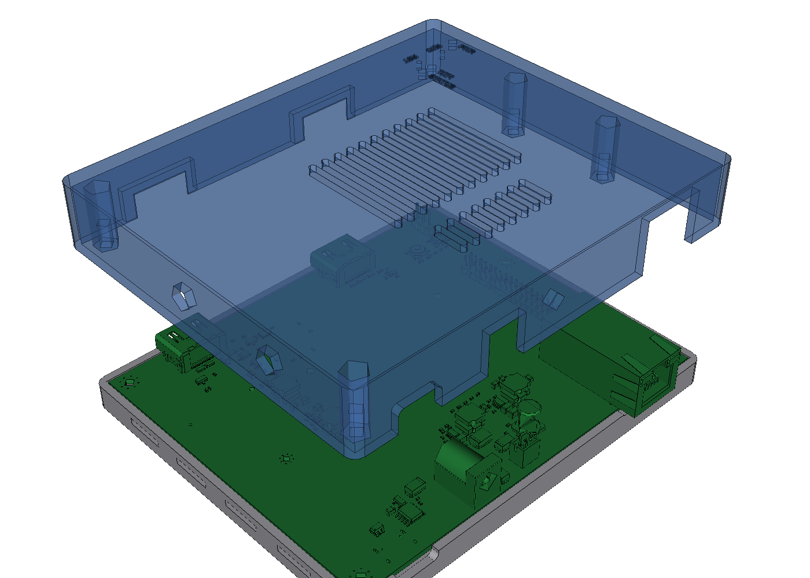
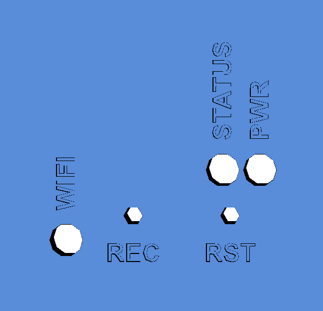

# Case: 3D-printed, for the rev A board (draft 1, Oct 24, 2026)

A base tray and a lid, **125.2 × 105.2 × 26.4 mm** outside. The board's four M3 holes clamp base, board and lid
together with four screws from underneath. Made for the 50-unit pilot; a moulded or extruded case can replace it
for production ([PRODUCTION.md](../PRODUCTION.md)).

| | |
|---|---|
|  |  |
| Front: HDMI IN (left), HDMI OUT; light pipes and pinholes on the roof | Rear: USB-C, DC IN, battery lead, Ethernet; antennas on the left side |
|  |  |
| Lid lifted: four posts come down onto the board's mounting holes | Roof labels, as seen from the front |

## Files

| File | What |
|---|---|
| [`case.py`](case.py) | The parametric model (CadQuery). All sizes and positions are at the top. |
| [`render.py`](render.py) | Renders `out/view-*.png` |
| `out/base.stl`, `out/lid.stl` | Print files |
| `out/case.step` | Both parts, for other CAD tools |
| `ref/relay-board.step` | The board with its parts, exported from KiCad (not in git; see below) |

To rebuild:

```bash
pip install cadquery
```

```bash
KICAD10_3DMODEL_DIR=/Applications/KiCad/KiCad.app/Contents/SharedSupport/3dmodels /Applications/KiCad/KiCad.app/Contents/MacOS/kicad-cli pcb export step --subst-models --force -o case/ref/relay-board.step kicad/relay.kicad_pcb
```

```bash
python case/case.py --check && python case/render.py
```

`--check` intersects both parts with the board's 3D model, plus blocks for the parts that have no model: the CM3
module and a 30 × 30 × 6 mm heatsink, the Wi-Fi card, the M.2 socket, the USB-C socket and the fuse. It fails on
any overlap larger than 0.5 mm³. It also probes what a solid test cannot see: a 12 × 6.5 mm USB-C plug overmould
from the socket face out, and the solid stop above each tripod insert hole. Today it passes.

## Layout

- **Front wall:** both HDMI sockets. Their faces are 1.0 mm past the board edge; the wall is pocketed around each
  opening (22 × 12 mm) so a cable's overmould reaches the socket.
- **Rear wall:**
  - USB-C (the opening reaches 2.4 mm below the board top, notching the base wall, so the plug's overmould reaches
    the recessed socket) and DC IN.
  - The battery lead hole (5 mm, for a grommet), for the NP-F plate's lead to J102.
  - Ethernet. **The magjack sticks out 2.9 mm** past the wall: on rev A it overhangs the board edge by 5.5 mm. Rev B
    should line it up with the other rear connectors.
- **Left wall:** two RP-SMA bulkheads (6.6 mm D-holes, 6.0 mm across the flat), 30 mm apart, next to the Wi-Fi
  card.
- **Roof:**
  - 3 mm light pipes over STATUS (D601, white), WIFI (D602, blue) and PWR (D603, red).
  - 1.8 mm pinholes over RESET and RECOVERY (press with a paperclip).
  - Vent slots over the CM3, and over the 5 V bucks U103/U104 (hot air out; the low side vents are the intake).
  - Engraved labels.
- **Base:**
  - Two ¼"-20 inserts underneath for a rig mount or an NP-F battery plate. Each boss rises to 0.2 mm under the board;
    the 5 mm insert hole leaves 0.8 mm of solid boss as a stop, so a longer screw bottoms there, not on the board.
  - Side vents low on the left and right walls.
  - Recesses for four 10 mm rubber feet.

**Heights** (from the board's STEP model): the magjack is the tallest part at 15.1 mm, so the roof sits 16.8 mm
above the board. Through-hole pins stick out 2.0 mm underneath, so the board sits on 4 mm standoffs.

## Printing

| | Base | Lid |
|---|---|---|
| Orientation | Floor on the bed | **Roof on the bed** (upside down) |
| Material | PETG or ASA (not PLA: the CM3 runs warm) | Same |
| Layer, walls | 0.2 mm, 3 walls, 25% infill | 0.2 mm, 3 walls, 25% infill; 0.4 mm nozzle is fine for the labels |
| Supports | None | None (the wall openings are notches open at the bottom edge) |
| Material use | about 40 g | about 55 g |

## Hardware per case

| Part | Qty | Note |
|---|---|---|
| M3 heat-set insert, 4.0 mm hole, 5.7 mm long (e.g. Ruthex M3) | 4 | Into the lid posts |
| M3 × 10 socket-head screw | 4 | From underneath, through the base's counterbore and the board, into the lid post's insert (about 5.6 mm of thread in the insert) |
| ¼"-20 heat-set insert, 8 mm hole, 0.2" (5 mm) long | 2 | Into the base, from underneath; a ¼"-long insert does not fit the 5 mm hole |
| Rubber bumper, 10 mm | 4 | |
| 3 mm light pipe or clear acrylic rod, 15 mm long | 3 | |
| RP-SMA bulkhead pigtail (MHF4 or U.FL to suit the card), 100 mm | 2 | |
| Grommet, 5 mm hole | 1 | Only with the NP-F plate |

## Assembly

1. Press the M3 inserts into the lid posts and the ¼"-20 inserts into the base (soldering iron, insert tip).
2. Fit the board (with module, Wi-Fi card and heatsink) into the base.
3. Fit the antenna bulkheads into the lid's left wall; plug the pigtails into the Wi-Fi card.
4. Drop in the light pipes, lower the lid over the connectors, and fit the four screws from underneath.
5. Feet on.

## Not checked yet

- **No board has been in it.** Fit-check with the first rev A prototype, then adjust the opening sizes in `case.py`.
- **The CM3, heatsink, Wi-Fi card, USB-C socket and M.2 socket are blocks** (no 3D models). Check the real
  heights, particularly the heatsink on the module.
- **Thermals:** measure SoC temperature in the closed case (the PRODUCTION.md test, step 9). Add more vents or a
  taller heatsink if it runs over 85 °C.
- **Antenna placement:** on the left wall the antennas are 30 mm apart; check Wi-Fi range against the R5C.
